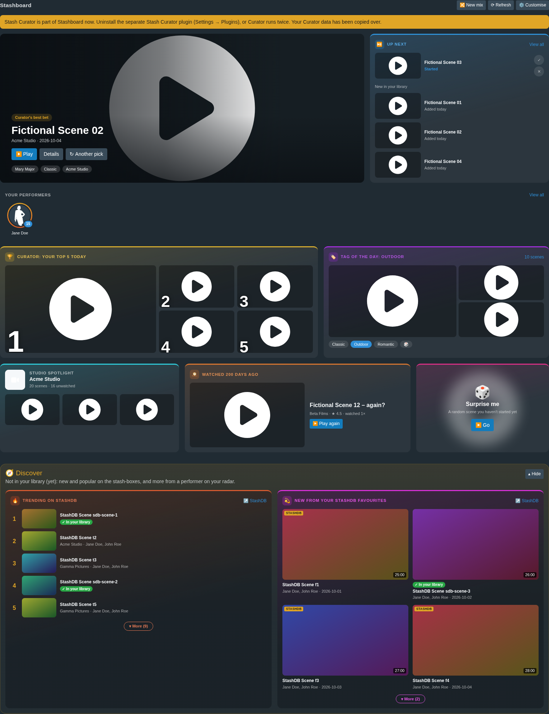
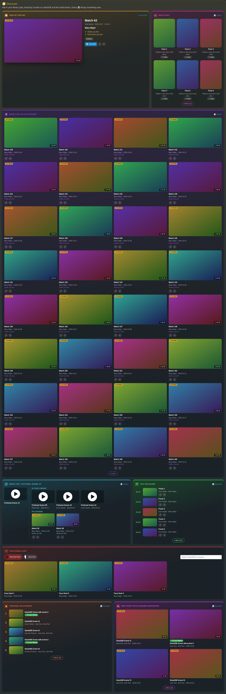
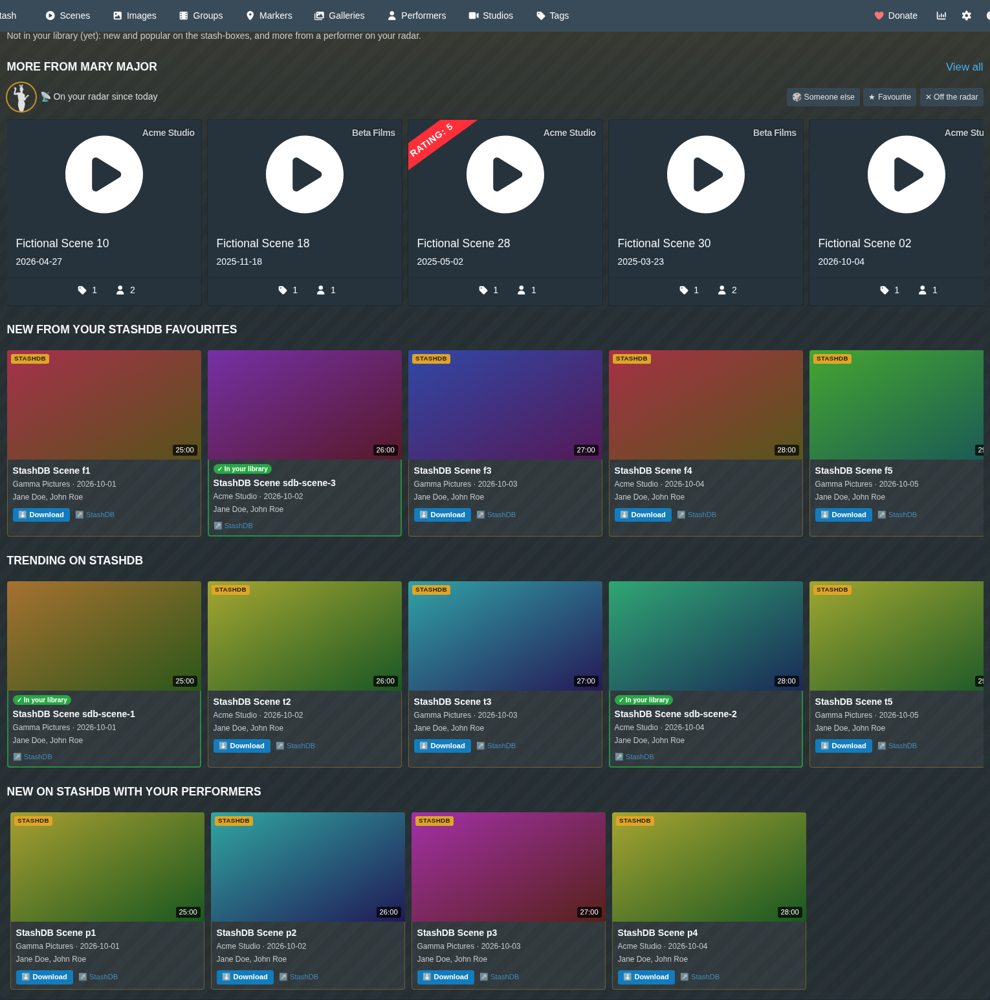

<div align="center">

# Stashboard

**A front page for Stash that gives you something to watch.**

A [Stash](https://github.com/stashapp/stash) plugin that turns the front page into a dashboard:
pick up where you left off, the day's tag and studio, what's trending on
[StashDB](https://stashdb.org), what's new from your favourites — and personal recommendations
from [Stash Curator](CURATOR.md), which comes with it.




<sub>Screenshots come from the end-to-end test: a fictional library, without video files, so Stash shows its placeholder images.</sub>

</div>

---

> ### Heads up: this is 100% vibecoded
>
> **This software is vibecoded.** It was written end to end by an AI (Claude) from
> natural-language prompts. No human wrote or reviewed the code by hand. It ships with automated
> tests but no warranty.
>
> It works, it's commented, and it's been thought through — but it has never seen a human code
> review. Read it before you run it. That's the deal.
>
> *(This notice is a licensing requirement, not just a disclaimer — see [License](#license).)*

---

## What's on it

A grid of modules in the spirit of streaming apps: each shows a handful of scenes, several sit
side by side, and the ones in a line grow to fill it when a neighbour has nothing to show. Hover a
picture for a moment and it pops out a little bigger and plays its preview (the spotlight too).
Your own front page rows stay below the dashboard unless you switch them off.

Stashboard has two tabs. **🏠 Home** is what's **in your library**; at its end a window leads to
**🧭 Discover**, a page of its own for everything that isn't in your library (yet), with a
**StashDB** label on each scene you don't have. Discover has its own address
(`/?stashboard=discover`), so Back and bookmarks work.

| Module | Source | What's in it |
|---|---|---|
| **Spotlight** | Curator, or your library | One big pick: Curator's best bet, else one of your top rated, else a random scene, with its performers, tags and studio. **▶ Play** starts it, **↻ Another pick** shows the next one. |
| **Up next** | Library | Next to the spotlight: the scenes you started, with a progress bar and the minutes left, then what's new in your library. Past 80% (setting **Watched from**) a scene counts as watched and leaves by itself; **✓** does the same for the others, **✕** deletes the unfinished viewing from the scene's history instead. |
| **Your performers** | Library | Your favourites and the performers on your [📡 radar](#-on-your-radar) as round faces; the number is how many of their scenes you haven't watched. Grey: nothing new. Click one with a number and their unwatched scenes open right below, pushing the page down; **🏹 Hunt** looks for theirs on StashDB in Discover. |
| **Curator: your top 5 today** | Curator | Curator's For you, ranked with big numbers in gold, silver and bronze. |
| **Tag of the day** | Library | A picture mosaic of a tag with at least four scenes, a different one every day; the chips switch to other tags, 🎲 draws new ones. |
| **Studio spotlight** | Library | A studio of the day with its logo, how many of its scenes you haven't watched, and three of them. |
| **Watched … days ago** | Library | One scene you played before, but not in the last 90 days: again? |
| **Surprise me** | Library | One random scene you haven't started, kept secret until **▶ Go**; 🎲 draws another. |
| **🧭 Find of the day** | Curator + StashDB | One of Curator's best StashDB matches, big, with why it fits; **↻ Next find** goes on. In Discover, like everything below. |
| **👯 New faces** | Curator + StashDB | Performers Curator thinks you'd like (Expand); **🏹 Hunt** shows their scenes in Performer Hunt. |
| **🔮 Made for you on StashDB** | Curator + StashDB | Curator's best matches (Expand), eight at a time and many more behind **More**. **📌** keeps one on your shortlist, **✕** says not interested (it isn't suggested again). |
| **🔗 More like …** | Curator | A scene you watched lately and what's like it, in your library and on StashDB (Similar). |
| **🌱 Just released** | Curator + StashDB | New on StashDB and to your taste, newest first. |
| **🏹 Performer Hunt** | Curator + StashDB | Everything of one performer on StashDB you don't have, best match first: your favourites and radar performers to pick from, anyone else by searching StashDB. |
| **📌 Your shortlist** | Curator | What you pinned, until you take it off. |
| **📡 On your radar** | Library + StashDB | One performer from your radar, a different one each visit: portrait, numbers, two of their unwatched scenes and two StashDB scenes you're missing. In Discover. |
| **Trending on StashDB** | StashDB | The top five there right now, as a chart. In Discover. |
| **New from your StashDB favourites** | StashDB | Released scenes of the performers and studios you favourited on StashDB. In Discover. |

**🎲** in a Discover module shows others, and **🎲 Shuffle Discover** in the toolbar has every
module draw something else. Curator's Find needs its StashDB catalogue; while that's still being
built, Discover says so and offers **Build it now** (Curator's task *Refresh Expand cache*).

Off by default, and there to switch on in **⚙ Customise**: **Recently added**, **Unwatched with
your favourites**, **Top rated**, Curator's **Best bets**, **Revisit**, **Stretch**, **Blind
spots** and **Dormant**, **New on StashDB with your performers** (new releases with the performers
in your library, favourites first) and **New on StashDB**. Each shows four scenes.

With [stasharr](https://github.com/brewing8309/stasharr) 1.6 or newer in Firefox, every StashDB tile
you don't have yet gets **⬇ Download**. It opens the scene on StashDB with stasharr's Prowlarr
search already running; you pick the release there. stasharr marks your Stash page when its
Stash URL is set, which is how Stashboard knows to show the button — without stasharr there's no
button, just the link to StashDB.

### 📡 On your radar

Someone caught your eye, but a favourite feels like too much? Click **📡** on their performer
card — on a scene's page, in the performer lists — or **📡 Radar** on their performer page. From
then they can turn up in **📡 On your radar** in Discover: their scenes in your library you
haven't watched yet, then their most popular StashDB scenes you don't have (with
[Curator](#curator-rows), the ones that fit your taste best), each with **⬇ Download** if
stasharr is around.

After 30 days on the radar, or once you've watched three of their scenes since, it asks:
**★ Favourite** or **✕ Off the radar**. Nothing is taken off by itself. Performers on the radar
also follow right after your favourites in **New on StashDB with your performers**.

The radar is a custom field on the performer in Stash (`radar: 2026-10-27`, the day it was set),
so it's yours, it shows on the performer's page, and anything can filter by it. The module shows
one of them at a time, picked at random each time the page loads (never the same one twice in a
row); **🎲 Someone else** picks another right away.





## Install

You need **Stash 0.31 or newer**, with Python available to Stash (as for most plugins): Stash
Curator's backend comes with Stashboard and runs through it. On Linux (x86-64, ARM64), macOS and
Windows (x86-64).

1. In Stash, open **Settings → Plugins → Available Plugins → Add Source** and add
   - Name: `Stashboard`
   - Source URL: `https://raw.githubusercontent.com/brewing8309/stashboard/main/index.yml`
   - Local path: leave it as suggested
2. Expand **Stashboard** in the list, tick **Stashboard** and click **Install**.
3. Reload the page and open the front page.

Updates show up in the same list (**Installed Plugins → Check for Updates**).

**Coming from the separate Stash Curator plugin?** Install Stashboard, open the front page once,
then uninstall Stash Curator (the dashboard reminds you while both are on). Stashboard copies
Curator's data — model, history, your answers — and its settings on first use.

### StashDB rows

The StashDB rows use the stash-box you already set up for scraping:
**Settings → Metadata Providers → Stash-box Endpoints**, with endpoint
`https://stashdb.org/graphql` and your StashDB API key (from your StashDB profile). Without it,
those rows simply aren't offered.

Also supported: **FansDB**, **PMV Stash** and **JAV Stash**, each with its own rows, switched off
by default. Other stash-boxes can't be reached from the browser — Stash only lets a plugin connect
to the hosts its manifest lists — and are named in the Customise dialog.

### Curator rows

[Stash Curator](CURATOR.md) is part of Stashboard: its For you is the top 5, its other lanes can
be switched on, and the Spotlight is its best bet. Its own pages, tasks and settings are there
too (**Curator** in the navigation bar, **Settings → Tasks**, **Settings → Plugins →
Stashboard**). It needs to have built its model once: **Sync and build recommendations** in
Curator or under Settings → Tasks.

## Make it yours

**⚙ Customise** on the dashboard: switch modules on and off and change their order within the
library part and within Discover. The layout is
saved in Stash, so it's the same in every browser. **⟳ Refresh** asks StashDB again right away.

More in **Settings → Plugins → Stashboard**:

| Setting | Default | What it does |
|---|---|---|
| **Hide Stash's own front page rows** | off | Show only Stashboard on the front page. |
| **Hide stash-box scenes you already have** | off | Leave owned scenes out of the StashDB rows instead of marking them. |
| **Don't contact stash-boxes** | off | Library and Curator rows only; StashDB is never asked for anything. |
| **Watched from (%)** | 80 | Scenes stopped past this point leave Up next and count as watched. 0 turns it off. |
| **Stash-box cache (hours)** | 6 | How long StashDB rows are kept before asking again; 0 turns the cache off. |
| **Radar decision after (days)** | 30 | When a radar row asks "favourite or off the radar?" (or after three of their scenes watched). |

Stash's interface language decides the dashboard's: German and English so far.

## What goes where

- **Your library and Curator** — read through Stash's own API, in your browser. Nothing leaves
  your Stash.
- **StashDB** (and the other stash-boxes) — your browser asks it directly, with your API key, for
  each StashDB row: trending, your StashDB favourites, new releases. The **New on StashDB with
  your performers** row sends the StashDB IDs of up to 50 performers from your library; switch
  that row off if you'd rather not. Answers are cached in your browser (6 hours by default).
- **Writes** — its own settings and layout (in Stash's plugin settings); scenes in Up next
  past **Watched from (%)** are marked watched by themselves (resume time reset, a play
  if Stash hasn't counted one). Everything else only when you click: **✓ Watched** (the scene's
  resume time and a play), **✕ Remove** (the resume time and the newest play), **📡** (the
  performer's `radar` field) and **★ Favourite** in a radar row (the performer's favourite flag).
  Nothing else in Stash is changed by the dashboard.
- **Curator** — keeps its model, your plays and answers in an SQLite file in Stashboard's plugin
  directory (`data/`, or the **Sidecar database path** setting), and does what its own pages and
  tasks say; see [its documentation](curator/README.md). On the first start Stashboard copies a
  separately installed Stash Curator's `data/` there, once, and leaves the original alone.

## Troubleshooting

| Symptom | Cause |
|---|---|
| No dashboard on the front page | Plugin not enabled (Settings → Plugins), or the page wasn't reloaded after installing. |
| No StashDB rows | No StashDB stash-box set up, **Don't contact stash-boxes** is on, or the rows are switched off in Customise. |
| "StashDB needs a valid API key" | The key under Settings → Metadata Providers → Stash-box Endpoints is wrong or expired. |
| No ✓ on StashDB scenes you have | Those scenes aren't linked to StashDB in Stash (no StashDB ID), or Stash is older than 0.31. |
| "Curator has no recommendations yet" | Run **Sync and build recommendations** in Curator. |
| No **⬇ Download** on StashDB tiles | stasharr isn't installed in this browser, is older than 1.6, or its Stash URL isn't this Stash's address (`http://host:9999`, port included). Owned scenes and other stash-boxes never get one. |
| No 📡 on a performer | They're already a favourite. |
| A radar row shows nothing new | Everything of theirs in your library is watched and StashDB has nothing you're missing — or they aren't linked to StashDB in Stash (no StashDB ID), so only the library part works. |
| A row is missing | It's empty — e.g. nothing half watched, no favourite performers, nothing rated. |
| StashDB rows look stale | They're cached for 6 hours; **⟳ Refresh** asks again. |

If Stashboard itself fails, the front page falls back to Stash's own; the browser console says why.

## Under the hood

```
plugin/stashboard.yml       Stashboard's part of the manifest: files, CSP for the stash-boxes, settings
plugin/stashboard-core.js   pure logic: rows, layouts, queries, seeds, cache, texts — tested in Node
plugin/stashboard.js        the React UI and the talking (Stash GraphQL, stash-boxes, Curator)
plugin/stashboard.css       styles
curator/                    Stash Curator, unchanged (git subtree) — see CURATOR.md
curator-adapter/            what Stashboard changes about it: plugin id, launcher, binaries lock
scripts/build.js            the deterministic zip and index.yml
scripts/curator.js          the merged manifest, Curator's files, building curator-core
tests/                      node:test unit and consistency tests
tests/e2e/                  end-to-end test against a real Stash (Playwright)
index.yml                   the plugin source Stash reads
```

Stashboard replaces Stash's `FrontPage` component through the plugin API and renders local scenes
with Stash's own `SceneCard`, fetched with Stash's own `FindScenes` query — so cards look and
behave like everywhere else in Stash, whatever version you run.

### Development

```sh
npm test                  # unit and consistency tests (Node 20+)
npm install               # Playwright, for the end-to-end test only
STASH_BIN=./stash-linux npm run e2e
```

The end-to-end test starts a real Stash on a temporary, fictional library, installs the plugin
from a local plugin source (so `index.yml`, the zip and its SHA-256 are tested too), fakes StashDB
and Curator, and walks through the dashboard. CI runs it against Stash 0.31.1 and the latest
development build on every push.

### Releasing

1. Bump `version` in `plugin/stashboard.yml`, add a `CHANGELOG.md` entry, run
   `node scripts/build.js --write-index` and commit (the tests fail if these disagree).
2. Push a tag `v<version>`. The Release workflow runs the tests, rebuilds the zip, checks it
   against `index.yml` and publishes it as a GitHub release.
3. `index.yml` on `main` points at that release — Stash sees the update once the release is up.

The zip is byte-for-byte reproducible, which is what lets `index.yml` carry its SHA-256 before the
release exists.

## License

[**GNU Affero General Public License v3.0 only**](LICENSE) (AGPL-3.0-only), like the
[Stash Curator](CURATOR.md) it includes. Releases up to 2.0.0 were published under the PolyForm
Noncommercial License 1.0.0 and stay available under it.

**You can:** use it, study it, change it and pass it on, also commercially.

**You must:** pass it on under the same license, with its source, including to people who only
use a changed version over a network. And, as an additional term under the license's section
7(b), keep both Required Notices with it — the copyright line and the vibecoded statement — and
keep them *visible* in any version you publish: in the README, and in the plugin's Customise
dialog. Reformat them however you like; just don't bury them or make them less prominent than
your own credits. Nothing requires you to call *your* changes vibecoded.

```
Required Notice: Copyright 2026 brewing8309 — https://github.com/brewing8309/stashboard
Required Notice: This software is vibecoded. It was written end to end by an AI (Claude) from natural-language prompts. No human wrote or reviewed the code by hand. It ships with automated tests but no warranty.
```

## Disclaimer

Stashboard shows what's in **your own** Stash and what the stash-boxes **you** set up list. It
hosts nothing, indexes nothing, downloads nothing and distributes nothing.

Not affiliated with Stash, StashDB or Stash Curator.
