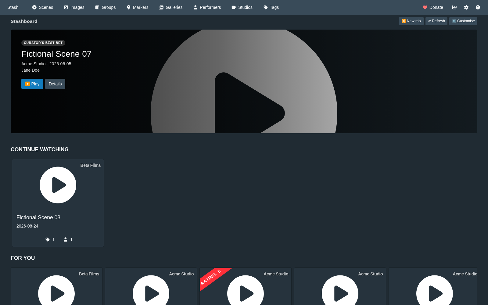
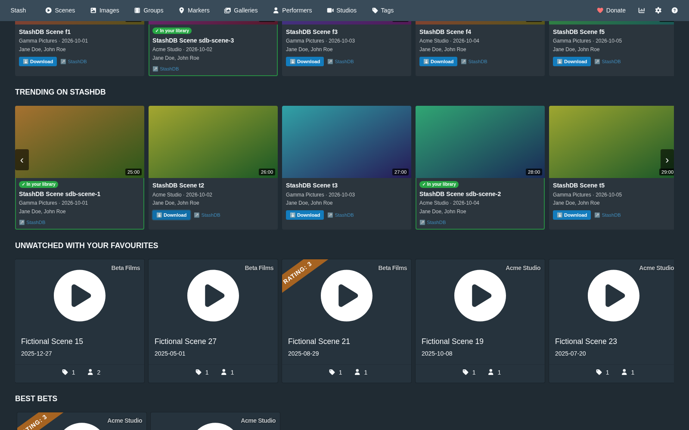

<div align="center">

# Stashboard

**A front page for Stash that gives you something to watch.**

A [Stash](https://github.com/stashapp/stash) plugin that turns the front page into a dashboard:
pick up where you left off, the day's tag and studio, what's trending on
[StashDB](https://stashdb.org), what's new from your favourites — and, if you use
[Stash Curator](https://github.com/mrx-31415/stash-curator), its personal recommendations.




<sub>Screenshots come from the end-to-end test: a fictional library, without video files, so Stash shows its placeholder images.</sub>

</div>

---

> ### Heads up: this is 100% vibecoded
>
> **This software is vibecoded.** It was written end to end by an AI (Claude) from
> natural-language prompts. No human wrote or reviewed the code by hand. It ships with automated
> tests but no warranty.
>
> It works, it's commented, and it's been thought through — but it has never seen a human code
> review. Read it before you run it. That's the deal.
>
> *(This notice is a licensing requirement, not just a disclaimer — see [License](#license).)*

---

## What's on it

Rows of scenes, each scrolling sideways, with Stash's own scene cards for everything in your
library. Rows with nothing to show stay hidden; your own front page rows stay below the
dashboard unless you switch them off.

| Row | Source | What's in it |
|---|---|---|
| **Spotlight** | Curator, or your library | One big pick: Curator's best bet, else one of your top rated, else a random scene. **▶ Play** starts it. |
| **Continue watching** | Library | Scenes you started and didn't finish. |
| **Recently added** | Library | The newest scenes in Stash. |
| **Unwatched with your favourites** | Library | Scenes with a favourite performer you haven't played or started. |
| **Tag of the day** · **Studio spotlight** | Library | One tag and one studio with at least four scenes, a different one every day. |
| **Not watched in a while** | Library | Played before, but not in the last 90 days. |
| **Top rated** · **Random picks** | Library | Rated 4 stars or more · anything at all. |
| **For you** · **Best bets** · **Revisit** | Curator | Curator's lanes, in Curator's order. **Stretch**, **Blind spots** and **Dormant** can be switched on. |
| **New from your StashDB favourites** | StashDB | Released scenes of the performers and studios you favourited on StashDB. |
| **Trending on StashDB** | StashDB | What's trending there right now. |
| **New on StashDB with your performers** | StashDB | New releases with the performers in your library (favourites first). |
| **New on StashDB** | StashDB | Everything just released; off by default. |

Everything "random" is random **per day**: the same all day, different tomorrow. **🔀 New mix**
draws again. StashDB scenes you already have are marked **✓ In your library** and open your
copy; the rest open on StashDB.



### Download with stasharr

With [stasharr](https://github.com/brewing8309/stasharr) 1.6 or newer in Firefox, every StashDB tile
you don't have yet gets **⬇ Download**. It opens the scene on StashDB with stasharr's Prowlarr
search already running; you pick the release there. stasharr marks your Stash page when its
Stash URL is set, which is how Stashboard knows to show the button — without stasharr there's no
button, just the link to StashDB.

## Install

You need **Stash 0.31 or newer**. Stashboard is a UI-only plugin: no Python, no database, nothing
to run.

1. In Stash, open **Settings → Plugins → Available Plugins → Add Source** and add
   - Name: `Stashboard`
   - Source URL: `https://raw.githubusercontent.com/brewing8309/stashboard/main/index.yml`
   - Local path: leave it as suggested
2. Expand **Stashboard** in the list, tick **Stashboard** and click **Install**.
3. Reload the page and open the front page.

Updates show up in the same list (**Installed Plugins → Check for Updates**).

### StashDB rows

The StashDB rows use the stash-box you already set up for scraping:
**Settings → Metadata Providers → Stash-box Endpoints**, with endpoint
`https://stashdb.org/graphql` and your StashDB API key (from your StashDB profile). Without it,
those rows simply aren't offered.

Also supported: **FansDB**, **PMV Stash** and **JAV Stash**, each with its own rows, switched off
by default. Other stash-boxes can't be reached from the browser — Stash only lets a plugin connect
to the hosts its manifest lists — and are named in the Customise dialog.

### Curator rows

If [Stash Curator](https://github.com/mrx-31415/stash-curator) is installed and enabled, its
lanes appear as rows and the Spotlight becomes Curator's best bet. Nothing to set up: Stashboard
asks Curator through Stash, the way Curator's own page does. Curator needs to have built its model
first (**Sync and build recommendations** in Curator).

## Make it yours

**⚙ Customise** on the dashboard: switch rows on and off and change their order. The layout is
saved in Stash, so it's the same in every browser. **⟳ Refresh** asks StashDB again right away.

More in **Settings → Plugins → Stashboard**:

| Setting | Default | What it does |
|---|---|---|
| **Hide Stash's own front page rows** | off | Show only Stashboard on the front page. |
| **Hide stash-box scenes you already have** | off | Leave owned scenes out of the StashDB rows instead of marking them. |
| **Don't contact stash-boxes** | off | Library and Curator rows only; StashDB is never asked for anything. |
| **Scenes per row** | 12 | 4 to 40. |
| **Stash-box cache (hours)** | 6 | How long StashDB rows are kept before asking again; 0 turns the cache off. |

Stash's interface language decides the dashboard's: German and English so far.

## What goes where

- **Your library and Curator** — read through Stash's own API, in your browser. Nothing leaves
  your Stash.
- **StashDB** (and the other stash-boxes) — your browser asks it directly, with your API key, for
  each StashDB row: trending, your StashDB favourites, new releases. The **New on StashDB with
  your performers** row sends the StashDB IDs of up to 50 performers from your library; switch
  that row off if you'd rather not. Answers are cached in your browser (6 hours by default).
- **Writes** — the only thing Stashboard ever saves is its own settings and layout, in Stash's
  plugin settings. It doesn't change scenes, performers or anything else.

## Troubleshooting

| Symptom | Cause |
|---|---|
| No dashboard on the front page | Plugin not enabled (Settings → Plugins), or the page wasn't reloaded after installing. |
| No StashDB rows | No StashDB stash-box set up, **Don't contact stash-boxes** is on, or the rows are switched off in Customise. |
| "StashDB needs a valid API key" | The key under Settings → Metadata Providers → Stash-box Endpoints is wrong or expired. |
| No ✓ on StashDB scenes you have | Those scenes aren't linked to StashDB in Stash (no StashDB ID), or Stash is older than 0.31. |
| "Curator has no recommendations yet" | Run **Sync and build recommendations** in Curator. |
| No **⬇ Download** on StashDB tiles | stasharr isn't installed in this browser, is older than 1.6, or its Stash URL isn't this Stash's address (`http://host:9999`, port included). Owned scenes and other stash-boxes never get one. |
| A row is missing | It's empty — e.g. nothing half watched, no favourite performers, nothing rated. |
| StashDB rows look stale | They're cached for 6 hours; **⟳ Refresh** asks again. |

If Stashboard itself fails, the front page falls back to Stash's own; the browser console says why.

## Under the hood

```
plugin/stashboard.yml       the plugin manifest: files, CSP for the stash-boxes, settings
plugin/stashboard-core.js   pure logic: rows, layouts, queries, seeds, cache, texts — tested in Node
plugin/stashboard.js        the React UI and the talking (Stash GraphQL, stash-boxes, Curator)
plugin/stashboard.css       styles
scripts/build.js            the deterministic zip and index.yml
tests/                      node:test unit and consistency tests
tests/e2e/                  end-to-end test against a real Stash (Playwright)
index.yml                   the plugin source Stash reads
```

Stashboard replaces Stash's `FrontPage` component through the plugin API and renders local scenes
with Stash's own `SceneCard`, fetched with Stash's own `FindScenes` query — so cards look and
behave like everywhere else in Stash, whatever version you run.

### Development

```sh
npm test                  # unit and consistency tests (Node 20+)
npm install               # Playwright, for the end-to-end test only
STASH_BIN=./stash-linux npm run e2e
```

The end-to-end test starts a real Stash on a temporary, fictional library, installs the plugin
from a local plugin source (so `index.yml`, the zip and its SHA-256 are tested too), fakes StashDB
and Curator, and walks through the dashboard. CI runs it against Stash 0.31.1 and the latest
development build on every push.

### Releasing

1. Bump `version` in `plugin/stashboard.yml`, add a `CHANGELOG.md` entry, run
   `node scripts/build.js --write-index` and commit (the tests fail if these disagree).
2. Push a tag `v<version>`. The Release workflow runs the tests, rebuilds the zip, checks it
   against `index.yml` and publishes it as a GitHub release.
3. `index.yml` on `main` points at that release — Stash sees the update once the release is up.

The zip is byte-for-byte reproducible, which is what lets `index.yml` carry its SHA-256 before the
release exists.

## License

[**PolyForm Noncommercial License 1.0.0**](LICENSE) — source available, not open source.

**You can:** use it, fork it, modify it, redistribute it, run it at home or in any nonprofit,
school or public institution.

**You must:** keep both Required Notices with it — the copyright line and the vibecoded
statement — and keep them *visible* in any version you publish: in the README, and in the
plugin's Customise dialog. Reformat them however you like; just don't bury them or make them less
prominent than your own credits. Nothing requires you to call *your* changes vibecoded.

**You can't:** charge money for it, or use it commercially in any form.

```
Required Notice: Copyright 2026 brewing8309 — https://github.com/brewing8309/stashboard
Required Notice: This software is vibecoded. It was written end to end by an AI (Claude) from natural-language prompts. No human wrote or reviewed the code by hand. It ships with automated tests but no warranty.
```

## Disclaimer

Stashboard shows what's in **your own** Stash and what the stash-boxes **you** set up list. It
hosts nothing, indexes nothing, downloads nothing and distributes nothing.

Not affiliated with Stash, StashDB or Stash Curator.
